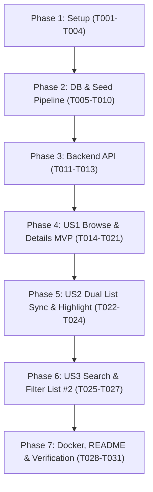

# Tasks: State Population Browser

**Input**: Design documents from `specs/001-state-population-browser/` (`spec.md`, `plan.md`, `data-model.md`, `contracts/states-api.yaml`, `quickstart.md`).

**Prerequisites**: All design artifacts ratified and checked against `.specify/memory/constitution.md`.

---

## Format: `[ID] [P?] [Story] Description`

- **[P]**: Can run in parallel (independent files and concerns).
- **[Story]**: Associated user story (US1: Browse & Details, US2: Dual List Sync & Highlight, US3: Search List #2, US4: Data Seeding & API).
- File paths are exact.

---

## Phase 1: Setup (Shared Infrastructure)

**Purpose**: Project initialization and basic directory structure for fullstack monorepo.

- [x] T001 Initialize repository root scripts and workspace orchestration in `package.json`
- [x] T002 [P] Initialize backend project with TypeScript, Express, `pg`, and testing dependencies in `backend/package.json` and `backend/tsconfig.json`
- [x] T003 [P] Initialize frontend project with React, TypeScript, Vite, and testing dependencies in `frontend/package.json`, `frontend/tsconfig.json`, and `frontend/vite.config.ts`
- [x] T004 [P] Create multi-container Docker Compose definitions in `docker-compose.yml`, `backend/Dockerfile`, and `frontend/Dockerfile`

---

## Phase 2: Foundational (Database & Seeding Pipeline - US4)

**Purpose**: Core PostgreSQL schema and mock data import pipeline. Must be complete before API or UI integration.

- [x] T005 Setup PostgreSQL connection pool and configuration in `backend/src/config/db.ts`
- [x] T006 [P] Create relational DDL schema for `states` and `counties` tables in `backend/src/db/schema.sql`
- [x] T007 Create database migration runner in `backend/src/db/migrate.ts`
- [x] T008 Implement standalone database seeding script in `backend/src/db/seed.ts` importing 51 states from `mock/usa-states/USA-states.json` and 3,143 counties from `mock/states/*.json` within a transaction
- [x] T009 Write integration test in `backend/tests/seed.test.ts` to verify exact counts (51 states, 3,143 counties) and the Iowa +1 discrepancy invariant
- [x] T010 Implement data access repository queries for states and counties in `backend/src/models/statesRepository.ts`

**Checkpoint**: Database schema and seeding pipeline fully functional and verified via automated test.

---

## Phase 3: Backend API (US4 - Priority: P1)

**Purpose**: REST API endpoints for state listing, detail retrieval, and healthchecks.

- [x] T011 Write API integration tests with Supertest in `backend/tests/statesApi.test.ts` for `GET /states`, `GET /state/:name`, and `GET /health`
- [x] T012 Implement request controllers and routing for `GET /states` and `GET /state/:name` in `backend/src/controllers/statesController.ts` and `backend/src/routes/statesRoutes.ts`
- [x] T013 Assemble Express application with CORS, JSON parser, error handling, and server listener in `backend/src/app.ts` and `backend/src/server.ts`

**Checkpoint**: Backend API is runnable and passes all integration tests.

---

## Phase 4: User Story 1 - Browse States & View County Breakdown (Priority: P1) 🎯 MVP

**Goal**: Users can scroll List #1 of states, click any state to load details, view all counties and populations, see the population sum, and identify discrepancies.

**Independent Test**: Click "California" -> verify matching sum. Click "Iowa" -> verify warning badge displaying +1 mismatch.

- [x] T014 [P] [US1] Define shared TypeScript interfaces (`State`, `County`, `PopulationComparison`) in `frontend/src/types/index.ts`
- [x] T015 [P] [US1] Implement frontend API client in `frontend/src/api/statesApi.ts` to request `/states` and follow `state.detail` URL
- [x] T016 [P] [US1] Implement `StateItem` component with single-click selection in `frontend/src/components/StateItem/StateItem.tsx` and `StateItem.module.css`
- [x] T017 [US1] Implement `StateList` component with constrained vertical scroll container in `frontend/src/components/StateList/StateList.tsx` and `StateList.module.css`
- [x] T018 [P] [US1] Implement `CountyList` component with scrollable table/list of counties in `frontend/src/components/CountyList/CountyList.tsx` and `CountyList.module.css`
- [x] T019 [US1] Implement `DetailPanel` component showing state info, county breakdown, population sum, and explicit mismatch indicator in `frontend/src/components/DetailPanel/DetailPanel.tsx` and `DetailPanel.module.css`
- [x] T020 [US1] Assemble MVP layout (List #1 and DetailPanel) with placeholder initial state in `frontend/src/App.tsx`, `frontend/src/App.module.css`, and `frontend/src/main.tsx`
- [x] T021 [US1] Write unit and component tests for `DetailPanel` population sum and discrepancy badge in `frontend/tests/DetailPanel.test.tsx`

**Checkpoint**: User Story 1 MVP fully functional. Evaluators can select states, review all counties, and inspect demographic sums.

---

## Phase 5: User Story 2 - Dual List Synchronization & Highlighting (Priority: P2)

**Goal**: Display duplicate State List #2. Double-clicking any state in either list toggles highlight status across both lists simultaneously. Single-clicking in List #2 also opens state details.

**Independent Test**: Double-click "Texas" in List #1 -> verify highlight appears in List #1 and List #2. Double-click "Texas" in List #2 -> verify unhighlighting in both. Single-click "Alaska" in List #2 -> verify details open.

- [x] T022 [US2] Add double-click highlight toggle handler to `StateItem.tsx` ensuring immediate selection without artificial click delay
- [x] T023 [US2] Add synchronized `highlightedStateNames` Set and instantiate second scrollable `StateList` in `frontend/src/App.tsx`
- [x] T024 [US2] Write component tests for dual list highlight synchronization and double-click interaction in `frontend/tests/DualListSync.test.tsx`

**Checkpoint**: Both state lists are live, synchronized in selection and highlighting.

---

## Phase 6: User Story 3 - Real-Time Search & Filtering on List #2 (Priority: P3)

**Goal**: Search input positioned above List #2 filters only List #2 in real time (case-insensitive substring match) without modifying List #1.

**Independent Test**: Type "ne" into search box -> List #2 shows only matching states (Maine, Nevada, Nebraska, Minnesota, etc.) with highlight status preserved, while List #1 retains all 51 states.

- [x] T025 [P] [US3] Implement `SearchBox` component with clear button in `frontend/src/components/SearchBox/SearchBox.tsx` and `SearchBox.module.css`
- [x] T026 [US3] Integrate `SearchBox` above List #2 in `frontend/src/App.tsx` with case-insensitive filtering applied exclusively to List #2
- [x] T027 [US3] Write component tests for real-time search filtering in `frontend/tests/SearchBox.test.tsx`

**Checkpoint**: All three user stories are complete and fully operational.

---

## Phase 7: Polish, Containerization & Verification

**Purpose**: Cross-cutting concerns, Docker verification, clean-clone onboarding, and AI transparency documentation.

- [x] T028 [P] Configure production and development build settings in `backend/Dockerfile` and `frontend/Dockerfile`
- [x] T029 Validate full container orchestration and seed flow using `docker compose up --build` and `docker compose exec backend npm run db:seed`
- [x] T030 Create comprehensive `README.md` with clean-clone setup guide, architecture overview, and AI collaboration disclosure per Constitution Principle VI
- [x] T031 Perform end-to-end clean-clone verification (database migration, seed, API tests, frontend interaction, discrepancy check for Iowa)
- [x] T032 Refactor architecture to single-service Express static serving and remove Nginx container

---

## Dependencies & Execution Flow

